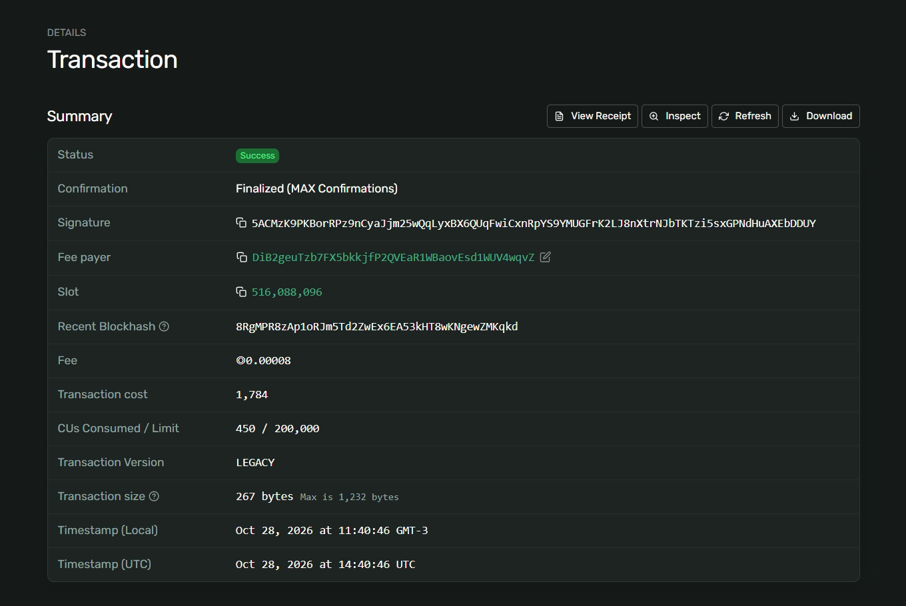

<p align="center">
  
</p>

# Isla Skills

The community robot that pays the people who teach it.

Isla Skills started at the IslandDAO V5 house in Florianópolis. Coco is a robot that belongs to the whole community. Developers publish skills with a price per use, the community votes on what Coco learns next, and every time Coco uses a skill, the community treasury pays the developer on Solana.

**Live demo:** https://isla-skills-dao-2b40fb.netlify.app

## How it works

1. **Publish.** A developer lists a skill (serve coffee, beach cleanup, visitor guide) with a price per use and a payout wallet.
2. **Vote.** People at the house vote on which skill Coco learns next. The winner gets installed.
3. **Work.** Coco runs its installed skills as tasks.
4. **Pay.** Each use sends a payment from the community treasury to the developer. 95% goes to the developer and 5% stays with the community.

## What's real today

- Payments are real **USDC** transfers on **Solana devnet** (SOL also works), approved in the user's wallet (Phantom, Solflare, Backpack or Brave Wallet) and verifiable on Solana Explorer.
- **Gasless USDC through x402:** with *Pay in: USDC · x402*, the wallet only signs and the [Ultravioleta DAO facilitator](https://facilitator.ultravioletadao.xyz) verifies the payment, pays the network fee and settles it on Solana devnet.
- Votes, new skills and closed rounds are saved on **Solana devnet** as memos signed by the voter's wallet, so everyone sees the same board. One wallet, one vote (the latest vote counts).
- The robot is a simulation in the browser.
- Without a wallet connected, the page runs in simulated mode.

<p align="center">
  
</p>

## Run it locally

It is a single static page, no build step.

```bash
git clone https://github.com/katamar-lang/isla-skills.git
cd isla-skills
npx serve .
```

Then open the local address in Chrome or Brave with a Solana wallet (Phantom, Solflare or Backpack) set to **Solana Devnet**. Wallets don't connect on `file://` pages, so use a local server.

You need a little devnet SOL for network fees (use the **Get devnet SOL** button or https://faucet.solana.com) and devnet USDC to pay for skills (https://faucet.circle.com, choose Solana Devnet).

## Project files

| File | What it is |
|---|---|
| `index.html` | The whole app: vote, robot, skill store, payments |
| `web3.min.js` | Solana web3.js 1.95.3 (IIFE build) with a Buffer polyfill, bundled so the page works without external CDNs |
| `favicon.png`, `apple-touch-icon.png` | Browser icons |
| `assets/` | Cover, logo and a screenshot of the first payment |

## Roadmap

- [x] Community demo with a simulated robot and devnet payments
- [x] Payments in USDC (devnet), with SOL as an option
- [x] Skills and votes saved on Solana devnet, so everyone sees the same state
- [x] One wallet, one vote, signed with the wallet
- [ ] Solana program for the skill registry and pay-per-use
- [ ] A low-cost open-source robot arm running a real skill
- [x] Gasless USDC payments through an x402 facilitator
- [ ] A limited daily budget so the robot can pay on its own (x402 makes this possible)

## License

MIT. See [LICENSE](LICENSE).
