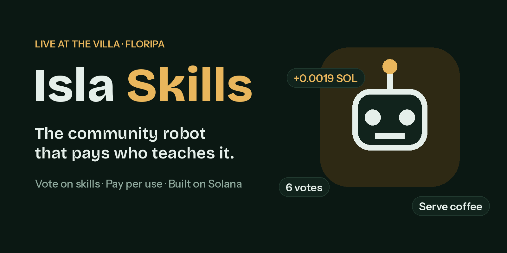

<p align="center">
  
</p>

# Isla Skills

**An app store for robot skills. Each skill is a service a robot calls and pays per use, in USDC on Solana, with x402. No human approves anything.**

Robots are learning new skills through software, but there's no way to pay for a skill each time a robot uses it. On Isla Skills, a skill is an API: the robot sends something (a photo, a reading), the skill answers, and the robot pays for that answer. Skills can come from AI models and from people.

**Live demo:** https://isla-skills-dao-2b40fb.netlify.app · **Earn by reviewing:** https://isla-skills-dao-2b40fb.netlify.app/review

## Clean Sweep

Coco is a cleaning robot for the IslandDAO V5 villa in Florianópolis (simulated: your phone camera plays its eyes). Take a photo of a room and it starts a chain of paid skills, each from a different service with its own wallet:

```
photo ─▶ Litter Spotter (AI)      402 ─▶ Coco pays 0.01 USDC  ─▶ litter list
           └─ AI not sure? ─▶ Human Reviewer (a person)  402 ─▶ Coco pays 0.005 USDC ─▶ the person's answer
      ─▶ Cleanup Planner           402 ─▶ Coco pays 0.002 USDC ─▶ cleanup plan
```

- **Litter Spotter** uses Claude (Haiku) with vision to say which room of the villa the photo shows and list the litter in it, with a confidence for each item.
- **Human Reviewer:** when the AI isn't sure ("is this cup still in use?"), Coco asks a person. Anyone can answer from `/review` with one tap and gets paid in USDC. If nobody answers in 20 seconds (or the person watching taps "Skip, use the AI's guess"), Coco goes on with the AI's guess and pays nothing.
- **Cleanup Planner** turns the list into a plan: order, recycling bins (Brazil's colours), time and % recyclable.
- When the photo is a villa room, a pop-up shows Coco walking there through real photos of the villa, picking the item up and taking it to the right bin (purely visual; the payments above are the real part).

The top of the page fits on one phone screen: Coco's real wallet balance going down, the photo being scanned, boxes on the litter, and three rings that fill as each skill is actually paid. The Patrol log at the bottom opens every step as **402 → paid → result**, with a Solana Explorer link for each payment, and live numbers read from Solana: photos analyzed, paid skill calls, USDC paid to skill makers, people paid for reviews.

## How Coco pays on its own (x402)

```
Coco ──POST /api/skills/litter-spotter──────────▶ skill
     ◀── 402 + paymentRequirements ─────────────  (payTo = the skill's wallet, amount, USDC, feePayer)
Coco's wallet signs one USDC transfer (no popup, no human)
Coco ──POST again + X-PAYMENT ──────────────────▶ skill ──/verify, /settle──▶ x402 facilitator ──▶ Solana devnet
     ◀── 200 result + X-PAYMENT-RESPONSE (transaction signature)
```

- **Coco's wallet** is one shared devnet wallet held by the server, with a **daily budget** (1 USDC). When it's used up, Coco stops and says so. It only pays a skill's own wallet, at the listed price, and never itself.
- **Every skill has its own wallet**, so the USDC goes straight to whoever made the skill (or to the reviewer who answered).
- **Visitors need no wallet** to watch Coco work. Anyone can top Coco up from their Solana wallet (Solflare, Phantom, Backpack…), connected through the official Solana wallet adapter; on Android phones it also finds the wallet app installed on the phone.
- The AI costs real money, so each visitor gets 5 photos a day and Coco analyzes up to 100 a day in total.
- The facilitator pays the network fee. Default: [Ultravioleta DAO](https://facilitator.ultravioletadao.xyz); configurable, with a built-in fallback that verifies and submits payments on the server.

## Run it locally

```bash
git clone https://github.com/katamar-lang/isla-skills.git
cd isla-skills
npm install
```

```bash
npx netlify-cli dev --dir . --functions netlify/functions
```

The site runs on Netlify (Functions + Blobs). The same code also runs on Vercel (`npx vercel dev`) with Upstash Redis for storage.

The server needs these environment variables (in a local `.env`, never committed, or in Netlify):

| Variable | What |
|---|---|
| `COCO_SECRET_KEY`, `SPONSOR_SECRET_KEY` | Devnet keys. Create them on your computer with `node scripts/new-keys.mjs` |
| `ANTHROPIC_API_KEY` | For Litter Spotter |
| `LITTER_SPOTTER_WALLET`, `CLEANUP_PLANNER_WALLET` | Payout wallets of each skill's maker |
| `X402_FACILITATOR_URL` | Facilitator URL, or `local` to verify and submit on the server |

Coco needs devnet USDC (send it from the page with your wallet; get test USDC at https://faucet.circle.com, Solana Devnet) and the sponsor wallet needs a little devnet SOL (https://faucet.solana.com).

## Project files

| File | What it is |
|---|---|
| `index.html` | Clean Sweep: one-screen patrol (take a photo, Coco's wallet, rings, skills), Patrol log, live numbers, top up |
| `villa-sim.js`, `assets/villa/` | The villa pop-up: Coco walks to the room the photo shows |
| `review.html` | Human Reviewer page: "Earn by helping robots, from anywhere." |
| `wallet.js`, `wallet-adapter.min.js` | Any Solana wallet through the official [Solana wallet adapter](https://github.com/anza-xyz/wallet-adapter) (Wallet Standard + Mobile Wallet Adapter on Android), plus phone links |
| `netlify/functions/` | `skills` (the x402 store), `coco` (Coco's wallet), `reviews`, `stats` |
| `api/router.mjs`, `vercel.json` | Runs the same handlers on Vercel |
| `netlify/lib/` | Shared server code: x402, Solana, Claude, planner, storage |
| `web3.min.js` | Solana web3.js 1.95.3 with a Buffer polyfill |

## Roadmap

- [x] Skills as paid services with x402 on Solana devnet
- [x] A robot that pays on its own, with a daily budget
- [x] AI skill (Litter Spotter) and human skill (Human Reviewer)
- [x] Any Solana wallet (Wallet Standard)
- [x] Usage numbers read from Solana
- [ ] Open the store to outside developers
- [ ] A low-cost open-source robot arm running a real skill
- [ ] People with limited mobility operating robots remotely and getting paid per task
- [ ] Solana program for the skill registry; mainnet

## Photo credits

Room photos in `assets/villa/` come from the villa's public rental listing (Temporada Livre). They are used only to show where Coco goes in this demo.

## License

MIT. See [LICENSE](LICENSE).
